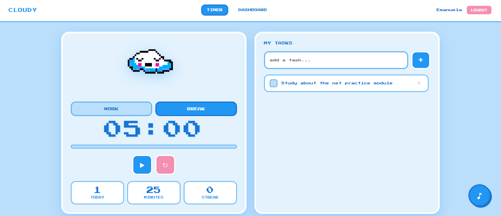
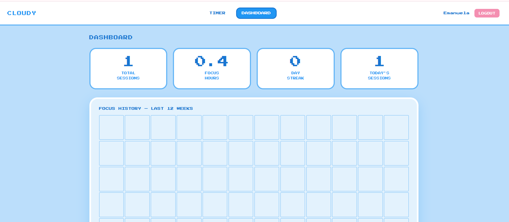

#  Cloudy — Pomodoro Focus Tracker


---

##  Features

- **Pomodoro Timer** — 25/5 work-break cycles with a progress bar and a hand-drawn pixel mascot that reacts to the current mode
- **Task Manager** — add, complete, and delete tasks that persist across sessions
- **Ambient Sounds** — toggle Rain / Café / Forest / Waves while you focus
- **Focus Dashboard** — 12-week heatmap calendar, streak counter, and total stats
- **User Auth** — register and log in with bcrypt-hashed passwords and session cookies

---

## Screenshots

| Login | Timer + Tasks | Dashboard |
|-------|--------------|-----------|
|  |  |  |

---

## Tech Stack

| Layer | Technology |
|-------|-----------|
| Frontend | HTML5, CSS3, Vanilla JavaScript |
| Font | Press Start 2P (pixel aesthetic) |
| Backend | Node.js + Express |
| Database | MySQL |
| Auth | express-session + bcrypt |
| Environment | dotenv |

---

##  Database Schema

```sql
users
  id            INT AUTO_INCREMENT PRIMARY KEY
  username      VARCHAR(50) UNIQUE NOT NULL
  password_hash VARCHAR(255) NOT NULL
  created_at    TIMESTAMP DEFAULT CURRENT_TIMESTAMP

tasks
  id         INT AUTO_INCREMENT PRIMARY KEY
  user_id    INT NOT NULL → FOREIGN KEY (users.id) ON DELETE CASCADE
  title      VARCHAR(255) NOT NULL
  done       BOOLEAN DEFAULT FALSE
  created_at TIMESTAMP DEFAULT CURRENT_TIMESTAMP

sessions
  id               INT AUTO_INCREMENT PRIMARY KEY
  user_id          INT NOT NULL → FOREIGN KEY (users.id) ON DELETE CASCADE
  duration_minutes INT NOT NULL DEFAULT 25
  session_date     DATE NOT NULL
  created_at       TIMESTAMP DEFAULT CURRENT_TIMESTAMP
```

---


##  Getting Started

### Prerequisites
- Node.js (v16+)
- MySQL (via XAMPP, MySQL Installer, or similar)

### 1. Clone the repo
```bash
git clone https://github.com/yourusername/cloudy-pomodoro.git
cd cloudy-pomodoro
```

### 2. Create the database
In MySQL Workbench or your MySQL client:
```sql
CREATE DATABASE cloudy;
```

### 3. Configure environment
```bash
cp .env.example .env
```
The `.env.example` file lists all required variables (`DB_HOST`, `DB_USER`, `DB_PASS`, `DB_NAME`, `SESSION_SECRET`, `PORT`). Open the new `.env` file and fill in your own values — in particular, set a unique `SESSION_SECRET` rather than using the placeholder.

### 4. Install dependencies
```bash
npm install
```

### 5. Add assets
- Place `cloud1.png` (work mode) and `cloud2.png` (break mode) in `public/`
- Place ambient sound files in `public/sounds/`: `rain.mp3`, `cafe.mp3`, `forest.mp3`, `waves.mp3`
  - Free sounds: [freesound.org](https://freesound.org) or [pixabay.com/music](https://pixabay.com/music)

### 6. Run
```bash
npm start
```
Open [http://localhost:3000/login.html](http://localhost:3000/login.html)

Tables are created automatically on first run — no migration step needed.

---

## 📁 Project Structure

```
cloudy-pomodoro/
├── server.js          # Express server + all API routes
├── db.js              # MySQL connection pool + schema init
├── .env               # Environment variables (not committed)
├── .env.example       # Template for setup
└── public/
    ├── style.css      # Shared styles across all pages
    ├── login.html     # Register / login page
    ├── index.html     # Timer + task panel
    ├── dashboard.html # Stats + heatmap
    ├── cloud1.png     # Work mode mascot (original pixel art)
    ├── cloud2.png     # Break mode mascot (original pixel art)
    └── sounds/
        ├── rain.mp3
        ├── cafe.mp3
        ├── forest.mp3
        └── waves.mp3
```

---

